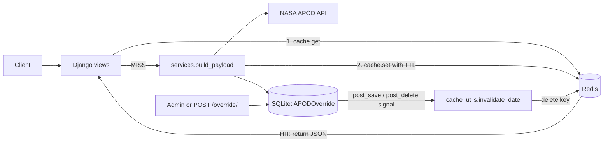

# Redis Caching and Cache Invalidation (Django + NASA APOD)

**Topic 6:** cache a slow endpoint in Redis, benchmark the response time before and after, and clear stale data when the source changes.

## Members and roles

| Member | Role | Owns |
|---|---|---|
| _Name 1_ | Backend / caching | `apod/views.py`, `apod/cache_utils.py` |
| _Name 2_ | Invalidation and data model | `apod/models.py`, `apod/signals.py` |
| _Name 3_ | Benchmarking and docs | `scripts/benchmark.py`, README |
| _Name 4_ | Testing and setup | `apod/tests.py`, docker-compose, env setup |

_Replace the names and adjust roles to match who actually did what. Everyone needs real commits._

## What it does

The slow part is the call to NASA's APOD API (hundreds of milliseconds to a couple of seconds). We expose the same data through three endpoints so the difference is easy to measure:

| Endpoint | Behaviour |
|---|---|
| `GET /api/apod/uncached/?date=YYYY-MM-DD` | Calls NASA every time (baseline). Header `X-Cache: BYPASS` |
| `GET /api/apod/low-level/?date=YYYY-MM-DD` | Low-level cache API (`cache.get` / `cache.set`) with our own key and TTL. Header `X-Cache: HIT` or `MISS` |
| `GET /api/apod/page-cached/?date=YYYY-MM-DD` | Per-view cache using Django's `@cache_page` |
| `GET /api/cache/stats/?date=...` | Hit and miss counters, hit ratio, seconds left on the key's TTL |
| `POST /api/cache/invalidate/?date=...` | Clear one date (no date clears everything) |
| `POST /api/override/` | Edit the "source" (JSON: `date`, `title`, `note`). Triggers automatic invalidation |

### Dashboard (the demo page)

Open http://127.0.0.1:8000/ once the server is running. It is one plain HTML page, no build step, and it is the easiest way to run the live demo:

- Buttons for the three endpoints, each logged with its HIT / MISS label and response time in ms
- Live Redis stats: hits, misses, hit ratio, and the TTL counting down for the chosen date
- A bar chart of response times so the drop on a hit is visible straight away
- "Run mini benchmark" (1 uncached call, 1 miss, 10 hits; only 2 calls to NASA)
- Invalidate one date or clear everything
- An override form: change the title, and the page immediately re-requests so you can watch the cache clear and a fresh MISS appear with the new title

### The invalidation story

NASA's data is read-only for us, so we added a local `APODOverride` model (editable in Django admin) that is merged into the response. That is the "source" that can change. A `post_save` / `post_delete` signal on that model deletes the cached entry for that date and clears the page cache. Errors from NASA are never cached.

## Architecture



## Setup

```bash
git clone <repo-url> && cd apod-cache
python -m venv .venv && source .venv/bin/activate
pip install -r requirements.txt

cp .env.example .env          # then put your NASA key in .env
docker compose up -d          # starts Redis on :6379
python manage.py migrate
python manage.py createsuperuser   # optional, for /admin
python manage.py runserver
```

Get a free key at https://api.nasa.gov/ . `DEMO_KEY` works but is limited to roughly 30 requests per hour per IP. `.env` is git-ignored, never commit a key.

**Practising without a key?** Set `USE_MOCK_NASA=1` in `.env` and the app returns fake NASA data after a simulated 0.8 second delay. Good for rehearsing the demo without using your rate limit. Set it back to `0` before recording the benchmark numbers you submit, because mock timings are not real API timings. The dashboard shows a badge telling you which mode you are in.

Run the tests (no Redis needed, they use an in-memory cache):

```bash
python manage.py test apod --settings=config.test_settings
```

Run the benchmark (server must be running):

```bash
python scripts/benchmark.py --date 2024-01-15
```

The benchmark makes only about 6 calls to NASA in total. The rest of its requests are served from our own Redis cache. We never load test the public API.

## Benchmark results

_Fill this in from your own run, and add a screenshot of the terminal output._

| Scenario | Time (ms) |
|---|---|
| Uncached (avg of 3) | |
| Low-level MISS | |
| Low-level HIT (avg of 20) | |
| Page-cache MISS | |
| Page-cache HIT (avg of 20) | |
| After invalidation (fresh MISS) | |

Speed-up (uncached / hit): _x_

## Screenshots

_Add: the dashboard after a mini benchmark (chart plus log), the override form followed by a fresh `MISS`, the terminal output of `scripts/benchmark.py`, and `redis-cli keys '*'`._

## Research questions (in our own words)

_These are starting points. Rewrite them in your own words and be ready to explain them in the demo._

**1. Cache hit vs miss?**
A hit means the data we want is already in the cache, so we return it straight away and skip the slow work. A miss means it is not there (never stored, expired, or invalidated), so we do the slow work (call NASA), store the result, then return it. The first request for anything is always a miss. The hit ratio (hits divided by total requests) tells us how useful the cache is. Our `/api/cache/stats/` endpoint tracks it.

**2. What is TTL and why is invalidation hard?**
TTL (time to live) is how long an entry stays in the cache before Redis deletes it automatically. It is a safety net: even if we forget to clear something, it cannot stay stale forever. A short TTL gives fresher data but more misses; a long TTL gives faster responses but older data.
Invalidation is hard because the cache is a copy and the source can change at any time without the cache knowing. We need to find every cached copy that depends on the changed data, and that is not always obvious. In this project the same date lives in the low-level cache and inside full-page cache entries, and the page cache keys are built from the whole URL and headers, so we could not easily rebuild the exact key for one date. We ended up deleting page entries by prefix, which is safe but clears more than strictly needed. There are also timing problems (a request can refill the cache with old data just as we invalidate) and the trade-off between over-invalidating (slower) and under-invalidating (stale data).

**3. Per-view caching vs low-level caching in Django?**
Per-view caching (`@cache_page`) stores the entire HTTP response for a URL. It is one line of code and good for pages that are the same for everyone, but we have little control: the key is derived from the URL and headers, and targeted invalidation is awkward. Low-level caching (`cache.get` / `cache.set`) lets us choose the key, TTL and exactly what to store (here, the merged data rather than a whole response). It takes more code but gives precise invalidation, hit/miss counters, and the option to reuse the cached data in several views. We built both and compare them in the benchmark.

## Project layout

```
config/        Django settings and urls (test_settings.py uses locmem cache)
apod/          app: models, services (NASA call), views, cache_utils, signals, tests
apod/templates/apod/dashboard.html   the demo dashboard
scripts/       benchmark.py
docker-compose.yml   Redis
```

## Notes

- The override and invalidate endpoints are unauthenticated demo helpers. In a real deployment they would need auth.
- `@cache_page` replays the stored response headers, so a page-cache hit would still say it was fresh. The view works around this by labelling the response `HIT` whenever the inner view did not run.
- Redis-specific helpers (`delete_pattern`, `ttl`) come from `django-redis`; if a different cache backend is used the code falls back to `cache.clear()`.
