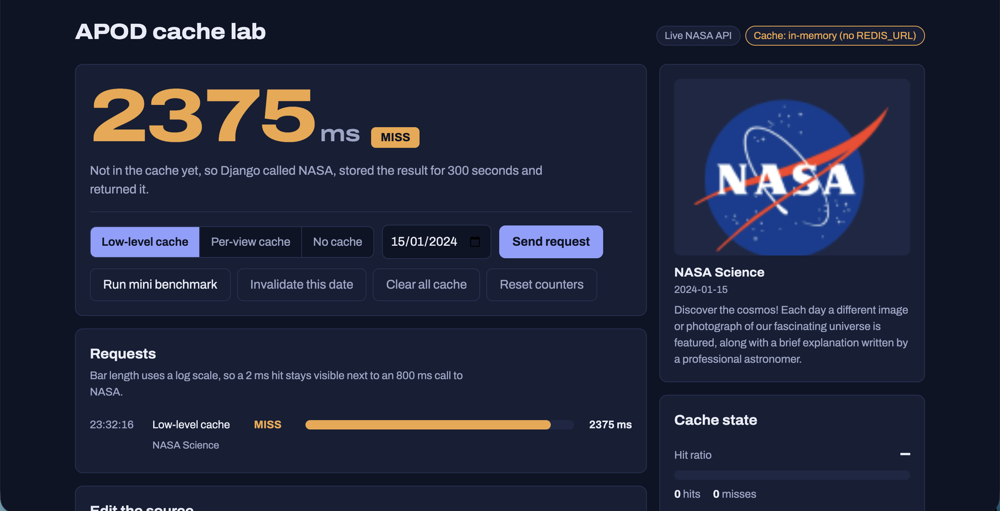
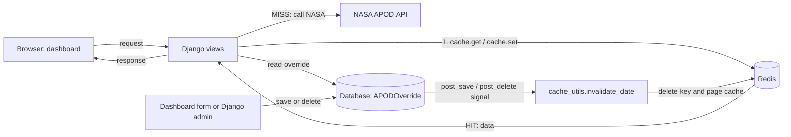
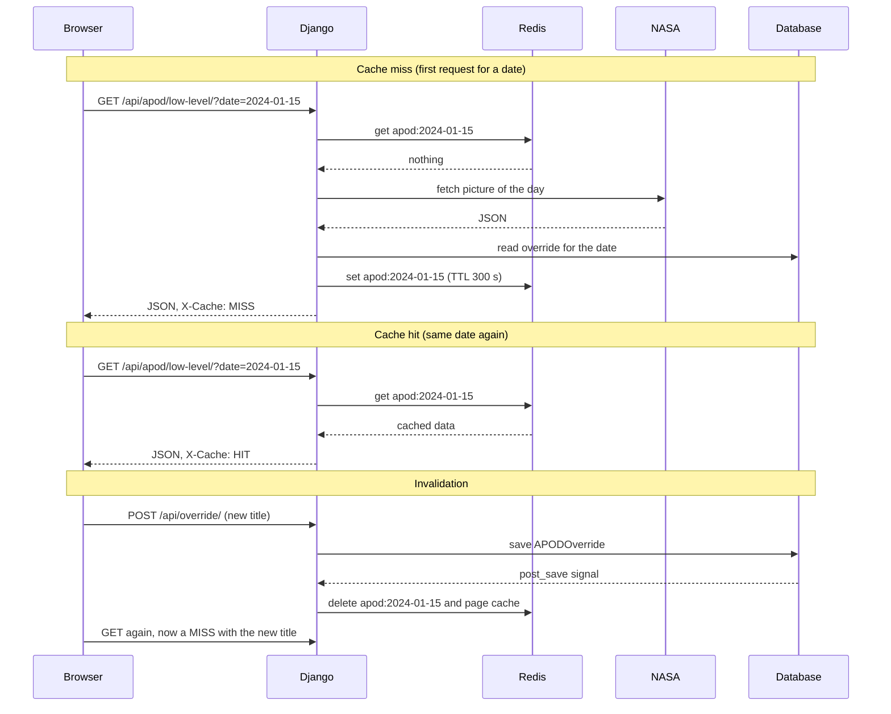

# Redis Caching and Cache Invalidation with Django and NASA APOD

**Project topic 6:** cache a slow endpoint in Redis, benchmark the response time before and after, and clear stale data when the source changes.

| | |
|---|---|
| Live demo | https://imap-project-chi.vercel.app/ |
| Repository | https://github.com/vihaang123/imap_project |
| API used | [NASA APOD](https://api.nasa.gov/) (free key) |
| Docs used | [Django cache framework](https://docs.djangoproject.com/en/stable/topics/cache/) |



_The deployed dashboard. The first request for a date is a cache MISS: Django called NASA (2375 ms), stored the answer in the cache for 300 seconds, and returned it._

## 1. Overview

Every request for NASA's Astronomy Picture of the Day makes our server call NASA over the internet. That call is slow (2375 ms on the deployed site) and NASA limits how often a key may call it. Many visitors ask for the same date, and the answer for a date rarely changes, so repeating the call is wasteful.

We built a Django application that stores each NASA answer in Redis for 300 seconds. Later requests for the same date are answered from Redis without calling NASA. To keep the cache honest, we added an editable layer (a local title override per date). Saving or deleting an override fires a Django signal that deletes the cached copy, so stale data is cleared the moment the source changes instead of waiting for the TTL to expire.

The project has three parts: the caching layer, the invalidation mechanism, and a dashboard that makes both visible during a live demo.

## 2. Team and roles

| Member | Roll no. | Role | Main files | Should be able to explain |
|---|---|---|---|---|
| Vihaan Gandhi | E002 | Backend and caching | `apod/views.py`, `apod/services.py`, cache settings in `config/settings.py` | The cache-aside flow, low-level vs per-view caching, how HIT and MISS are labelled |
| Jash Visaria | E003 | Invalidation and data model | `apod/models.py`, `apod/signals.py`, `apod/apps.py`, invalidation helpers in `apod/cache_utils.py`, `apod/admin.py` | Signals, `invalidate_date` and `invalidate_all`, why the page cache is cleared by pattern, the invalidation race |
| Calvin D'souza | E013 | Benchmarking, testing and documentation | `scripts/benchmark.py`, `apod/tests.py`, `config/test_settings.py`, this README | Benchmark method and how to read it, what the 12 tests prove, rate-limit handling, research answers |
| Arnav Jha | E009 | Dashboard and deployment | `apod/templates/apod/dashboard.html`, `api/index.py`, `vercel.json`, `docker-compose.yml`, `.env.example` | What every dashboard control does, the log-scale bars, Vercel serverless deployment and environment variables |

Every member should be able to explain the whole flow in section 5, not only their own files. A longer study guide with likely questions is kept alongside this repository.

## 3. Technology stack

| Tool | Role in the project |
|---|---|
| Python, Django 5 | Web framework: views, ORM, signals, admin, cache framework |
| Redis 7 | In-memory cache with automatic expiry (TTL) |
| django-redis | Django cache backend for Redis; provides `delete_pattern` and `ttl` |
| requests | HTTP client for the NASA API (15 second timeout) |
| NASA APOD API | The slow external data source being cached |
| SQLite, or Postgres through `DATABASE_URL` | Stores the title overrides, the changeable "source" |
| python-dotenv | Loads settings and the API key from a git-ignored `.env` file |
| WhiteNoise | Serves the admin's static files on Vercel |
| HTML, CSS, vanilla JavaScript | The dashboard (single file, no build step) |
| Docker Compose | Runs Redis locally with one command |
| Vercel | Serverless hosting for the live demo |
| GitHub | Source hosting; every push to `main` redeploys |

## 4. Architecture



### Request flows



## 5. How it works

### Endpoints

| Endpoint | Behaviour |
|---|---|
| `GET /` | The dashboard |
| `GET /api/apod/uncached/?date=YYYY-MM-DD` | Calls NASA every time. Header `X-Cache: BYPASS` |
| `GET /api/apod/low-level/?date=YYYY-MM-DD` | Low-level cache API (`cache.get`, `cache.set`) with our own key and TTL. Header `X-Cache: HIT` or `MISS` |
| `GET /api/apod/page-cached/?date=YYYY-MM-DD` | Per-view cache with `@cache_page`. Header `X-Cache: HIT` or `MISS` |
| `GET /api/cache/stats/?date=...` | Hit and miss counters, hit ratio, seconds left on the key's TTL |
| `POST /api/cache/invalidate/?date=...` | Delete one date's cache (no date deletes everything) |
| `POST /api/cache/stats/reset/` | Reset the counters |
| `POST /api/override/` | Save a title override (JSON: `date`, `title`, `note`). Triggers automatic invalidation |

### Caching design

- **Pattern:** cache-aside. Check the cache, on a miss load from NASA, store with a TTL, return.
- **Keys:** `apod:<date>` per date (`apod:today` without a date). Django's `KEY_PREFIX` adds `apodproj` so keys cannot clash with other apps.
- **TTL:** 300 seconds, configurable with `APOD_CACHE_TTL`.
- **Errors are never cached,** so a NASA failure or rate limit is not served to other visitors.
- **Counters** for hits and misses live in the cache, so they are shared across processes when Redis is used.

### Invalidation design

1. **Automatic.** A `post_save` and `post_delete` receiver on `APODOverride` calls `invalidate_date`, which deletes `apod:<date>` and clears the per-view page-cache entries. It fires however the row changes: the dashboard form, the Django admin, or code.
2. **Manual.** The invalidate endpoint and the dashboard buttons clear one date or everything.
3. **Passive.** The TTL removes anything that was missed.

### The dashboard

A single page with: a large response-time readout tagged HIT or MISS, an endpoint selector, a date picker, a mini benchmark (1 uncached call, 1 miss, 10 hits, only 2 NASA calls), invalidation buttons, an "edit the source" form, a request list with log-scale bars, the NASA picture for the chosen date, and a cache-state panel with the hit ratio and a TTL countdown. Badges show whether NASA data is live or mock and which cache backend is in use.

## 6. Setup

```bash
git clone https://github.com/vihaang123/imap_project.git
cd imap_project
python -m venv .venv && source .venv/bin/activate     # Windows: .venv\Scripts\activate
pip install -r requirements.txt

cp .env.example .env        # then put your NASA key in .env (never commit it)
docker compose up -d        # starts Redis on port 6379
python manage.py migrate
python manage.py createsuperuser   # optional, for /admin
python manage.py runserver
```

Open http://127.0.0.1:8000/. Get a free key at https://api.nasa.gov/. The shared `DEMO_KEY` works but allows only about 30 requests per hour per IP.

| Variable | Purpose |
|---|---|
| `NASA_API_KEY` | Your NASA key |
| `REDIS_URL` | Redis address, default `redis://127.0.0.1:6379/1` |
| `APOD_CACHE_TTL` | Seconds an entry lives, default 300 |
| `USE_MOCK_NASA`, `MOCK_NASA_LATENCY` | Fake NASA data with a simulated delay, for rehearsal only |
| `DJANGO_SECRET_KEY`, `DJANGO_DEBUG` | Django settings |
| `DATABASE_URL` | Optional Postgres address |

**Rehearsing without using the rate limit:** set `USE_MOCK_NASA=1`. Switch it back to `0` before recording the numbers you submit, because mock timings are not real API timings.

**Tests** (12 tests; they use an in-memory cache and a mocked NASA call, so they need neither Redis nor a key):

```bash
python manage.py test apod --settings=config.test_settings
```

**Benchmark** (with the server running):

```bash
python scripts/benchmark.py --date 2024-01-15
```

The script makes about 6 NASA calls in total. The remaining requests are answered by our own cache. We never load test NASA.

## 7. Deployment

The app is deployed on Vercel from this repository. `vercel.json` routes every URL to `api/index.py`, which exposes Django's WSGI application as a serverless function and runs migrations on a cold start. Pushes to `main` redeploy automatically.

Environment variables are set in the Vercel project settings, never in the repository:

| Variable | Notes |
|---|---|
| `NASA_API_KEY` | Sensitive |
| `DJANGO_SECRET_KEY` | Sensitive |
| `DJANGO_DEBUG` | `0` |
| `REDIS_URL` or `KV_URL` | Provided by a hosted Redis (Upstash) connected through Vercel Storage |
| `DATABASE_URL` | Optional hosted Postgres |

**Status of the cache on the live site:** a Vercel function is short-lived and has no Redis beside it, so a hosted Redis must be connected. Without one the app falls back to a per-instance in-memory cache and the dashboard badge reads "Cache: in-memory", which makes hits and counters inconsistent across instances. When Redis is connected the badge reads "Cache: Redis". The live demo during the presentation is run locally with Redis, where timings are cleanest.

## 8. Results

### Benchmark

Record these from a run with `USE_MOCK_NASA=0` and a real key.

| Scenario | Time (ms) |
|---|---|
| Uncached, average of 3 | |
| Low-level cache MISS | |
| Low-level cache HIT, average of 20 | |
| Per-view cache MISS | |
| Per-view cache HIT, average of 20 | |
| After invalidation (fresh MISS) | |

Speed-up (uncached divided by hit): ____

**Measured so far:** one real MISS on the deployed site took **2375 ms** (screenshot above). In a local mechanism check with a simulated 0.8 second NASA delay, cache hits took 2 to 9 ms against about 850 ms for a miss. That run measures our code and Redis rather than NASA, so it is not quoted as the project's result.

### Screenshots to add

- The dashboard after a mini benchmark, showing a HIT with its time and the request list
- The "edit the source" form followed by a fresh MISS with the new title
- Terminal output of `python scripts/benchmark.py`
- `redis-cli keys '*'` showing the cached entries

### Tests

12 tests pass. They cover: a miss then a hit calls NASA once; the uncached endpoint always calls NASA; saving or deleting an override invalidates the cache; the manual invalidate endpoint; invalid dates return 400; counters add up; NASA errors are not cached; page-cache hits are labelled correctly; the page cache is cleared by an override; the dashboard loads; mock mode never makes a real HTTP call.

## 9. Research questions

**1. What is a cache hit versus a cache miss?**
A hit means the data we want is already in the cache, so we return it immediately and skip the slow work. A miss means it is not there, either because it was never stored, its TTL ran out, or we deleted it. On a miss we do the slow work (call NASA), store the result and return it. The first request for any date is always a miss. The hit ratio, hits divided by total requests, tells us how useful the cache is, and `/api/cache/stats/` reports it.

**2. What is TTL and why is invalidation hard?**
TTL (time to live) is how many seconds an entry stays in the cache before Redis removes it automatically. It is a safety net: even if we forget to clear something, it cannot stay wrong forever. A short TTL gives fresher data but more misses, and a long TTL gives faster responses but older data.
Invalidation is hard because the cache is a copy and the source can change without the cache knowing. We have to find every cached copy that depends on the changed data, and that is not always obvious. In this project the same date lives in the low-level cache and inside full-page cache entries, and the page entries are keyed by the whole URL and headers, so we could not rebuild the key for one date. We delete page entries by pattern, which is safe but clears more than needed. There are also timing problems, such as a request refilling the cache with old data just as we invalidate, and a constant balance between deleting too much (slower) and too little (stale).

**3. Per-view caching versus low-level caching in Django?**
Per-view caching (`@cache_page`) stores the whole HTTP response for a URL. It is one line of code and suits pages that are identical for everyone, but we have little control: the key comes from the URL and headers, and targeted invalidation is awkward. Low-level caching (`cache.get`, `cache.set`) lets us choose the key, the TTL and exactly what to store, here the merged data rather than a whole response. It takes more code but gives precise invalidation, hit and miss counters, and reuse of the data in other views. We built both and compare them in the benchmark.

## 10. Rate limits and security

- The benchmark makes about 6 NASA calls and the dashboard benchmark makes 2. Everything else is served from our cache. We never load test a public API.
- The API key is read from an environment variable. Locally it lives in `.env`, which `.gitignore` excludes; on Vercel it is a sensitive variable. `.env.example` lists names only.
- Production runs with `DJANGO_DEBUG=0` and a restricted `ALLOWED_HOSTS`.
- The override and invalidate endpoints are unauthenticated demo helpers. A real deployment would need authentication.

## 11. Limitations and future work

- Connect a hosted Redis to the live site so every serverless instance shares one cache.
- Set `IGNORE_EXCEPTIONS` so a Redis outage is treated as a miss instead of an error.
- Add protection against cache stampedes (a lock, or serving the old value while refreshing).
- Replace pattern deletion with versioned keys or cache tags.
- Count hits for the per-view endpoint as well.
- Use a longer TTL for past dates, which never change, and a short one for today.
- Add authentication to the admin endpoints.

## 12. Project layout

```
config/          Django settings and URLs (test_settings.py uses an in-memory cache)
apod/            models, services (NASA call), views, cache_utils, signals, tests
apod/templates/apod/dashboard.html    the dashboard
scripts/benchmark.py                  command-line benchmark
api/index.py, vercel.json             Vercel entry point and routing
docker-compose.yml                    local Redis
docs/                                 screenshots
```

## 13. References

- [Django cache framework](https://docs.djangoproject.com/en/stable/topics/cache/)
- [django-redis](https://github.com/jazzband/django-redis)
- [Redis documentation](https://redis.io/docs/)
- [NASA open APIs](https://api.nasa.gov/)
